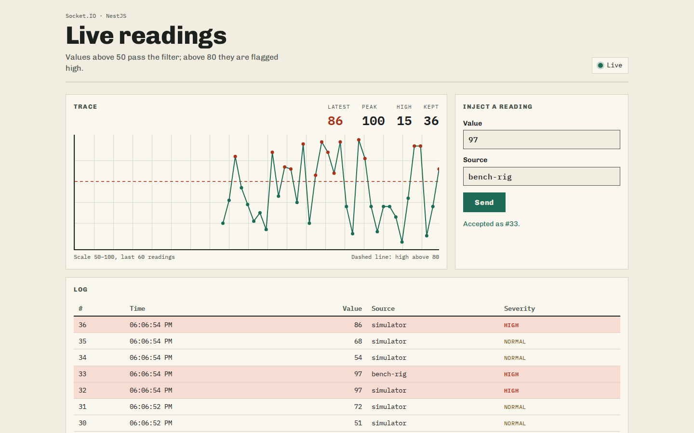
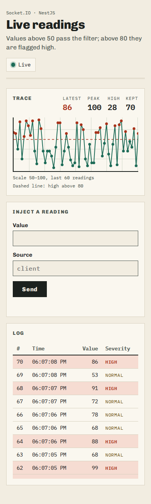
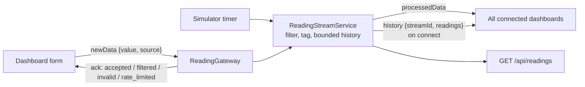

# Real-time readings (NestJS + React)

A small streaming app: a NestJS Socket.IO gateway receives numeric readings,
drops anything at or below 50, tags values above 80 as `high`, and
rebroadcasts the rest to every connected browser. A React dashboard draws
the stream as a strip chart and log, and lets you inject readings by hand.
A built-in simulator produces a reading every two seconds so there is
always something to watch.





## What it does

- **Gateway** (`backend/src/stream/`): validates each `newData` payload,
  filters and tags it, assigns an id, keeps the last `HISTORY_SIZE`
  readings in memory and emits `processedData` to all clients.
- **Replay on connect**: every client gets a `history` event with the
  buffered readings and a `streamId` that changes on each server start. The
  dashboard merges the replay by id after a reconnect and throws its old
  list away if the stream id changed.
- **Origin checks**: browsers do not apply CORS to WebSocket upgrades, so
  the server checks the `Origin` header on every Socket.IO handshake. Pages
  served by the same host are allowed, other origins must be listed in
  `CORS_ORIGINS`, and `*` is refused. Clients that send no `Origin`
  (scripts, other servers) are allowed.
- **Rate limit**: `newData` is limited per client address
  (`RATE_LIMIT_MAX` per `RATE_LIMIT_WINDOW_MS`), so reconnecting does not
  reset the budget.
- **Dashboard** (`frontend/`): connection badge with reconnect attempts,
  strip chart of the last 60 readings, latest/peak/high counts, a form that
  explains each server reply, and loading, empty and offline states.



The server is a single process with in-memory state. History and rate
limit counters are lost on restart, and running several instances would
need a Socket.IO adapter (for example Redis) and a shared limiter; neither
is included.

## Running it

Requires Node 22 (`.nvmrc`) or Docker.

### Docker Compose

```sh
docker compose up --build
```

Open http://localhost:3000. If port 3000 is taken, run
`HOST_PORT=3100 docker compose up --build` and open that port instead. The
container runs as the `node` user on a read-only filesystem.

### Node

```sh
npm run setup   # npm ci in backend/ and frontend/
npm run build   # Vite builds into backend/public, then nest build
npm start       # serves the UI, the API and Socket.IO on PORT (default 3000)
```

For development, run the two halves in separate terminals:

```sh
npm run start:dev --prefix backend   # Nest in watch mode on :3000
npm run dev --prefix frontend        # Vite on :5173, proxies /socket.io and /api to :3000
```

The Vite proxy keeps the browser on one origin, so no `CORS_ORIGINS` entry
is needed. Set `VITE_SOCKET_URL` (see `frontend/.env.example`) only if the
UI should talk to a backend on another origin, and add the UI's origin to
`CORS_ORIGINS` on that backend.

Installing at the repository root no longer installs anything else: the old
`postinstall` hook that ran `npm install` in `backend/` was replaced by the
explicit `setup` script. The `Procfile` runs `npm start`, and
`heroku-postbuild` runs `setup` and `build`; that deploy path has not been
tested.

### Configuration

All backend settings are optional environment variables, listed with their
defaults in `backend/.env.example`:

| Variable | Default | Meaning |
| --- | --- | --- |
| `PORT` | `3000` | HTTP and Socket.IO port |
| `CORS_ORIGINS` | empty | Extra browser origins, comma-separated |
| `HISTORY_SIZE` | `100` | Readings kept for replay and `/api/readings` |
| `RATE_LIMIT_MAX` / `RATE_LIMIT_WINDOW_MS` | `10` / `10000` | `newData` budget per client address |
| `SIMULATOR_INTERVAL_MS` | `2000` | Simulator period; `0` turns it off |
| `STATIC_DIR` | `backend/public` | Built frontend to serve |

## API

Socket.IO events, captured from a local run:

```text
<- history {"streamId":"315969ad-e772-4d4b-9a4c-e4d8ce2957b8","readings":[{"id":4,"value":92,"source":"simulator","severity":"high","processedAt":"2026-11-10T18:05:56.844Z"}]}
-> newData {"value":93,"source":"bench-rig"}   ack {"status":"accepted","id":5}
-> newData {"value":42}                        ack {"status":"filtered"}
-> newData {"value":"hot"}                     ack {"status":"invalid","error":"value must be a finite number"}
```

A rate-limited send is acknowledged with
`{"status":"rate_limited","retryAfterMs":...}`. Accepted readings are
broadcast as `processedData` with the same shape as the entries in
`history`. Only `value` (0 to 100) and `source` (1 to 40 letters, digits,
spaces, dots, dashes or underscores; defaults to `client`) are kept from a
payload.

HTTP:

```text
$ curl -s localhost:3000/api/health
{"status":"ok"}

$ curl -s localhost:3000/api/readings
[{"id":1,"value":51,"source":"simulator","severity":"normal","processedAt":"2026-11-10T18:05:16.667Z"},
 {"id":2,"value":67,"source":"simulator","severity":"normal","processedAt":"2026-11-10T18:05:18.670Z"}, ...]
```

Any other `GET` outside `/api` and `/socket.io` returns the dashboard's
`index.html`.

## Tests

```sh
npm test    # backend then frontend
npm run lint
```

- Backend (Vitest): unit tests for validation, the bounded history, the
  rate limiter, config parsing and the origin policy, plus end-to-end tests
  that start the Nest app on a random port and drive it with
  `socket.io-client` (broadcast, acks, rate limiting across reconnects,
  history replay, restart detection, origin rejection, HTTP routes).
- Frontend (Vitest + Testing Library): reading merge logic and the
  dashboard against a fake socket (loading, empty and offline states,
  reconnect replay, server restart, listener cleanup, form acks).

## Project layout

```text
backend/    NestJS 12 app: src/stream (gateway, service, validation), test/ (e2e)
frontend/   React 19 + Vite 8 dashboard
Dockerfile  two-stage image, runs as node
compose.yaml
```

## License

MIT, see [LICENSE](LICENSE).
